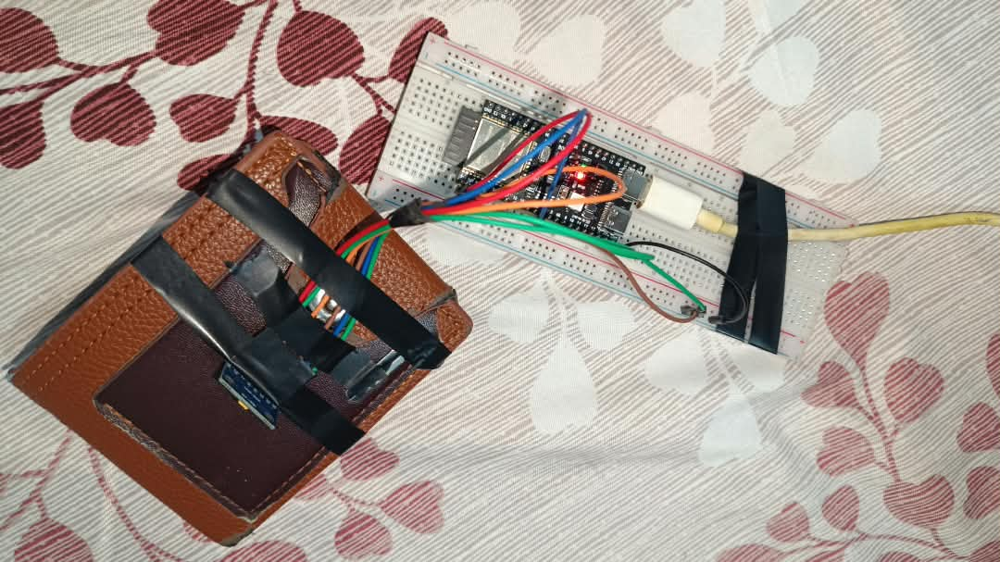
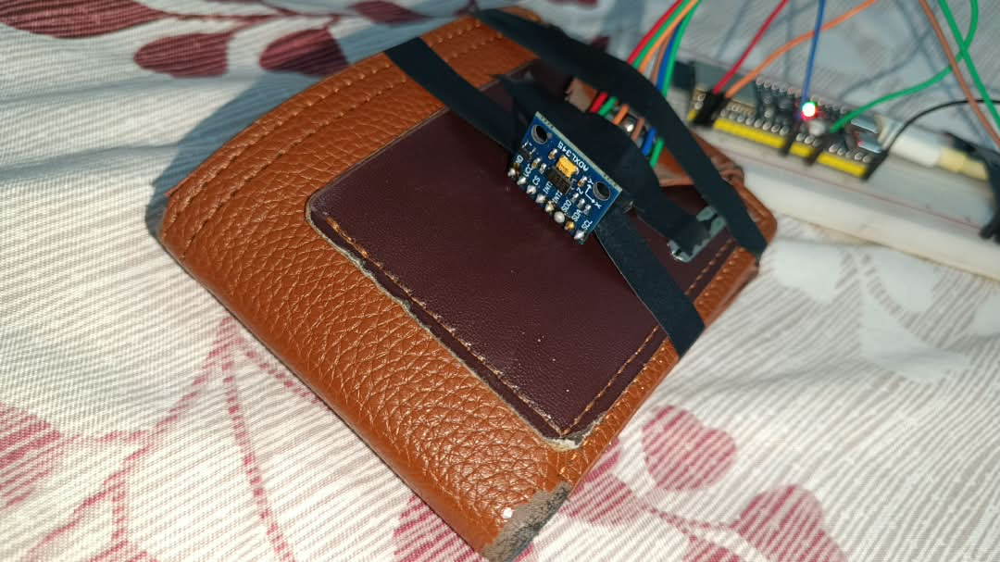
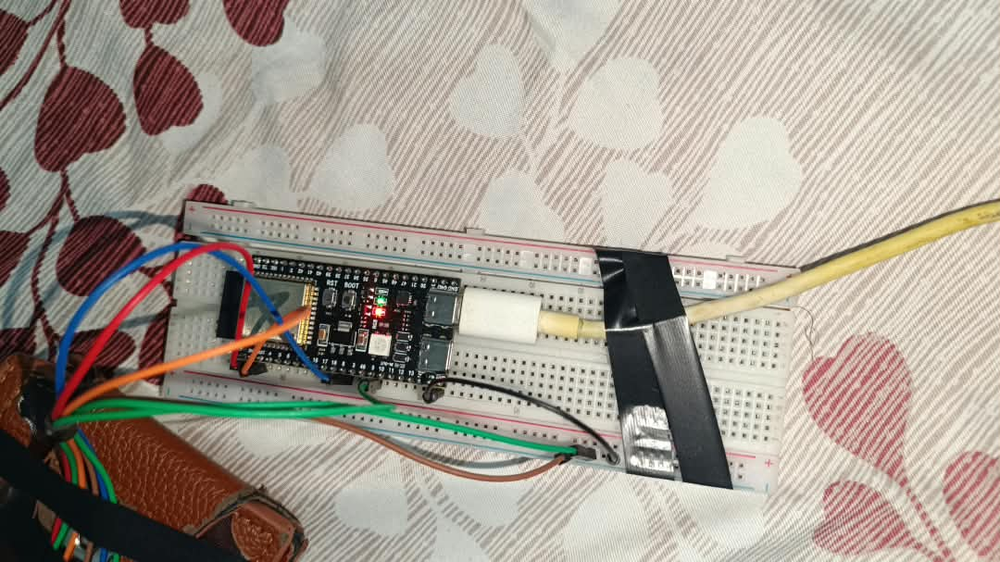

# Détecteur de chute ESP32-S3 + ADXL345 (Edge Impulse)

Il s'agit d'un détecteur de chute. Sa particularité est qu'il est propulsé par un modèle de machine learning directement installé sur un microcontrôleur ESP32. L'inférence se fait localement, sans cloud ni PC, c'est-à-dire que les données sont collectées et analysées sur place pour ensuite faire une prédiction.



## Le projet

Ce projet consiste à détecter une chute à partir de l'accélération de l'objet sur les trois axes x, y et z. Cette détection est faite par un réseau de neurones qui se charge de classer les différents mouvements en trois classes (normal, chute, ramasser). Le choix des classes plutôt que d'un seuil s'explique par le fait que ce dernier est fixe, et que des mouvements brusques peuvent être pris pour une chute alors que ce n'est pas le cas. Le modèle de classes nous offre une meilleure souplesse : on peut créer une classe pour chaque cas de figure afin de ne pas les confondre, et ainsi mieux détecter les chutes. Ce type de projet peut avoir plusieurs applications concrètes, comme la détection des chutes des personnes âgées, ou celle d'objets précis comme un portefeuille.

## Matériel et câblage

| Composant | Détail |
|---|---|
| Carte | ESP32-S3 WROOM-1 N16R8 (16 Mo de flash, 8 Mo de PSRAM) |
| Capteur | ADXL345, accéléromètre 3 axes, en I2C, réglé sur ±16 g |
| Liaison | I2C, SDA sur GPIO 8 et SCL sur GPIO 9 |
| Alarme | message sur le moniteur série (alarme sur téléphone prévue) |

Pour les essais, le capteur est fixé sur un portefeuille et relié à la carte, montée sur une breadboard.

| Le capteur ADXL345 | La carte ESP32-S3 |
|---|---|
|  |  |

Câblage : VCC sur 3V3, GND sur GND, SDA sur GPIO 8, SCL sur GPIO 9, CS sur 3V3 (mode I2C) et SDO sur GND (adresse 0x53).

J'ai mis le capteur sur ±16 g parce qu'une chute dépasse facilement ±2 g, et avec une plage plus petite le pic de l'impact serait coupé.

## Fonctionnement

1. Collecte des données avec `edge-impulse-data-forwarder`, pour les trois classes.
2. Entraînement d'un réseau de neurones sur Edge Impulse.
3. Quantification du modèle en int8, pour qu'il tienne et s'exécute rapidement sur la carte.
4. Déploiement sous forme de bibliothèque Arduino, puis inférence en local sur l'ESP32.

## Le modèle

| Paramètre | Valeur |
|---|---|
| Classes | `normal`, `chute`, `ramasser` |
| Fréquence d'échantillonnage | environ 59 Hz |
| Fenêtre d'analyse | 118 échantillons × 3 axes (environ 2 s) |
| Format embarqué | TensorFlow Lite int8 |
| Occupation sur la carte | RAM 6,8 %, flash 6,3 % |
| Temps d'inférence | moins de 1 ms |

La classe `ramasser` sert pour les mouvements brusques qui ne sont pas des chutes (attraper ou secouer l'objet). Sans elle, attraper l'objet pourrait déclencher une fausse alerte.

## Résultats

| Métrique | Valeur |
|---|---|
| Précision (validation, int8) | 85,9 % |
| Précision (jeu de test, float32) | 83,66 % |
| ROC AUC | 0,97 |
| F1 de la classe `chute` | 0,90 |

Matrice de confusion (lignes : classe réelle, colonnes : classe prédite) :

| | chute | normal | ramasser |
|---|---|---|---|
| chute | 86,8 % | 5,3 % | 7,9 % |
| normal | 0 % | 90,2 % | 9,8 % |
| ramasser | 1,7 % | 18,1 % | 80,2 % |

Peu de fausses alertes (0 % des mouvements normaux et 1,7 % des manipulations sont classés en chute), mais environ 13 % des chutes ne sont pas détectées. La confusion entre `ramasser` et `normal` n'est pas grave, ce ne sont pas des chutes dans les deux cas.

En test réel sur la carte, j'ai fait 4 chutes et les 4 ont été détectées (score `chute` à 1,00). Quand je manipulais l'objet c'est bien `ramasser` qui sortait, pas d'alerte.

## Installation et utilisation

Prérequis : VS Code avec l'extension PlatformIO.

```bash
# Compiler
pio run

# Flasher la carte (adapter le port)
pio run -t upload --upload-port COM3

# Ouvrir le moniteur série (115200 bauds)
pio device monitor
```

Le modèle entraîné est déjà inclus dans `lib/`. Pour collecter de nouvelles données, il suffit de recopier `collecte/main_collecte.cpp` dans `src/main.cpp`, puis de lancer `edge-impulse-data-forwarder`.

## Structure du dépôt

- `src/main.cpp` : programme d'inférence
- `collecte/main_collecte.cpp` : programme de collecte
- `lib/` : bibliothèque exportée par Edge Impulse
- `images/` : photos du montage

## Difficultés rencontrées

- Le port série se déconnectait à chaque ouverture du moniteur. C'était DTR et RTS qui faisaient redémarrer la carte, je les ai désactivés dans `platformio.ini`.
- Il faut donner au modèle exactement les mêmes données qu'à l'entraînement (brutes, en m/s², plage ±16 g). Une simple conversion d'unité fausse les prédictions.
- En int8 la précision passe d'environ 94 % à 86 %, mais j'ai gardé cette version car elle est environ 4 fois plus légère.
- Pendant les tests, la carte redémarrait parfois à l'impact quand le câble USB était trop tendu.

## Pistes d'amélioration

- plus de données de chute (angles, hauteurs, surfaces différentes)
- alarme avec la LED RGB de la carte (GPIO 48) puis un buzzer
- version sur batterie, sans PC
